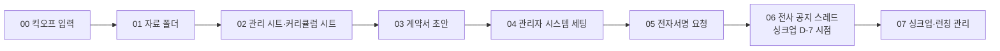

# 신규 강의 킥오프 반복 작업을 슬랙봇으로, 만들기 전에 설계와 승인 항목부터 정리한 사례
> 강의 하나를 열 때마다 반복되는 준비 작업을 전사 공용 슬랙봇으로 자동화하기 위해, 구현 전에 단계 순서·사람과 AI의 역할·사전 승인 항목을 설계한 기획 프로젝트.

| 역할 | 기간 | 사용 도구 |
|---|---|---|
| 기획·설계 (온라인 교육 플랫폼 Fastcampus(데이원컴퍼니) 콘텐츠 PM) | 2026.10 ~ 설계 단계 | AI 에이전트(Aside), 다이어그램(HTML/이미지), Google Docs |

## 문제
새 강의 하나를 열 때마다 담당 PM은 비슷한 작업을 순서대로 반복한다. 자료 폴더와 관리 시트 만들기, 계약서 초안 작성, 관리자 시스템 세팅, 전자서명 요청, 전사 공지 스레드 생성과 일정 관리. 사람마다 이름 규칙과 순서가 달라 누락이 생기고, 돈·개인정보가 오가는 단계가 섞여 있어 "어디까지 자동화해도 되는가"가 불분명했다.

## 접근 — 왜 이렇게 설계했나
- **만들기 전에 질문 세 가지를 먼저 정리했다.** 어떤 구조로 만들 수 있는가(개인 에이전트 / 스프레드시트 스크립트 + 메신저 워크플로우 / 회사 공식 봇), 어떤 승인이 필요한가, 어디서 사람이 개입하는가. 구조는 비교안으로 제시하고 확정하지 않았다.
- **AI가 필요 없는 일은 규칙 기반으로.** 정해진 규칙으로 되는 단계를 AI 없이 처리하면 보안 검토 부담이 줄고 결과가 예측 가능하다. 돈·개인정보·외부 발송이 걸린 단계는 사람이 직접 하거나 승인 버튼을 누르게 했다.
- **입력은 한 곳.** 강의 정보의 원본은 팀이 이미 관리하는 일정 보드 한 곳이다. 봇은 읽기만 한다.
- **순서를 의존 관계로 검증했다.** 처음엔 전자서명 요청이 관리자 세팅보다 앞이었는데, 관리자 시스템 접근이 별도 승인이라 순서를 바꿨다. 스레드 생성 시점은 "단계 순서"가 아니라 "런칭 일정 역산(싱크업 7일 전)"으로 분리했다. 마케터가 미배정일 수 있고, 너무 일찍 만든 스레드는 채널에서 묻히기 때문이다.
- **승인 전 단계는 사람이 대신하고 '완료' 버튼으로 이어 간다.** 연동 승인이 나기 전에도 흐름을 끊지 않고 단계별로 단계적 구축(Phase)이 가능하게 했다.
- **전사 배포를 전제로 한 표기.** 팀 전용 명칭과 실명은 역할명(팀장, 담당 마케터 등)으로 바꿔 어느 팀이든 읽을 수 있게 했다.

## 만든 것

- 8단계 워크플로우를 가로축(단계·시점), 세로축(PM / 봇 / 연결 시스템 / 구축 단계)으로 보여 주는 스윔레인 도식. 단계를 누르면 봇이 하는 일, 사람이 하는 일, 필요한 승인, 필요한 정보가 열리는 클릭형 HTML 버전도 만들었다(사내 식별자 없음).
- 구축 Phase 구분: 메신저·문서 권한만 있으면 되는 단계(Phase 1)와 사내망·관리자 시스템·전자서명 승인이 필요한 단계(Phase 2).
- 아직 정해지지 않은 처리 규칙 3개(담당자 미배정 시, 일정 공란 시, 수동 생성 스레드와 중복 시)를 열린 결정으로 명시하고, 각각 권장안을 붙여 질문했다.

## 결과 (Before → After)
- Before: 단계별 담당·순서·승인 필요 여부가 사람 머릿속에 흩어져 있음.
- After: 한 장의 도식과 단계별 입력·출력·승인 항목 표로 합의 가능한 설계 문서가 됐다. 구현은 아직 시작 전이며, 현재 성과는 "승인 요청서와 구축 범위를 바로 쓸 수 있는 상태"까지다. 자동화로 줄인 시간은 해당 없음(구축 전).

## 배운 점
- 자동화 프로젝트의 첫 산출물은 코드가 아니라 "무엇을 자동화하지 않을 것인가"의 선이다. 특히 돈과 개인정보가 걸린 단계의 경계를 먼저 그으면 승인 요청이 훨씬 빨라진다.
- 설계의 전제(승인 여부, 접근 권한, 정책)는 확인되기 전까지 모두 열린 항목으로 남겨야 한다. 확인되지 않은 가정을 사실처럼 쓰면 설계가 틀어진다.
- 도식은 읽는 사람의 질문에 맞춰 세 번 바꿨다(구성도 → 스윔레인 → 클릭형). 첫 그림이 맞는 정보를 담고 있어도 읽기 쉬운 형태가 따로 있었다.
