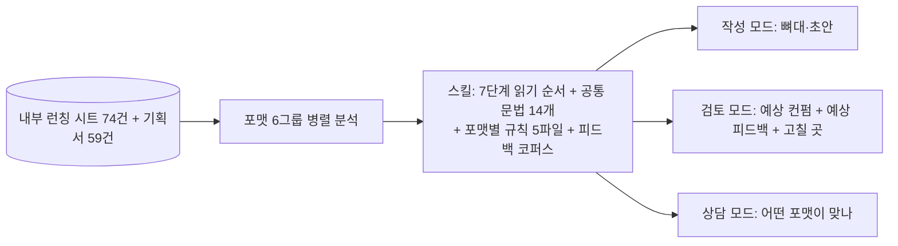

# 리뷰어의 컨펌 사고방식을 데이터에서 역추출해, 제출 전에 예상 피드백을 받는 기획 문법 스킬

> 내부 런칭 관리 시트에 흩어진 승인·피드백 기록 74건과 기획서 59건을 분석해 리뷰어의 읽기 순서와 반복 지적 패턴을 스킬로 만들고, 기획서를 쓰거나 제출 전에 검토할 때 호출한다.

| 역할 | 기간 | 사용 도구 |
|---|---|---|
| 기획·분석·스킬 설계 (온라인 교육 플랫폼 Fastcampus(데이원컴퍼니) 콘텐츠 PM) | 2026-10 | Aside(브라우저 에이전트), 구글 시트·문서 |

## 문제
- 기획서는 본부장 컨펌을 받아야 다음 단계로 간다. 같은 지적(유료 수요 근거 부족, 팔릴 이유의 우선순위 불명확, 개수를 강점으로 착각, 연사 선정 이유 부재 등)이 기획서마다 반복되었다.
- 피드백은 시트의 여러 칸에 짧은 문장으로만 남아 있고, 문서 안 코멘트는 없었다. 컨펌 기준이 사실상 한 사람의 머릿속과 시트 74행에 분산되어 있었다.

## 접근 — 왜 이렇게 설계했나
1. **기준을 묻지 않고 기록에서 뽑는다**: 인터뷰 대신 컨펌 결과, 피드백, "왜 컨펌했나" 칸, 메모를 코퍼스로 삼았다. 리뷰어의 말투와 판단이 원문 그대로 남는다.
2. **포맷별 병렬 분석**: 기획 포맷 6개 그룹을 서브에이전트 6개로 나누어 동시에 분석하고, 그룹별로 "통과한 모범"과 "지적된 패턴"을 정리했다.
3. **읽기 순서를 구조로**: 리뷰어는 앞 단계가 막히면 뒤를 보지 않는다. 그래서 7단계 순서(유료 수요 → 포맷 적합성 → 1순위 강점 → 대체재와의 차이 → 왜 이 연사 → 강의명에서 보이나 → 안 팔려도 할 말이 있나)를 작성 순서이자 검토 순서로 쓴다.
4. **품질과 통과를 분리**: 사람·키워드·시장 실험·브랜딩 목적처럼 문서 품질과 무관한 통과 요인이 섞여 있다. 검토 결과에서 "문서가 잘 쓰였나"와 "통과할까"를 따로 말한다.
5. **환각 방지**: 예상 피드백은 반드시 "예상"으로 표시하고, 리뷰어의 실제 발언은 코퍼스 원문만 인용한다. 근거 사례의 행 번호를 붙인다.
6. **표본의 한계를 명시**: 사례가 1~3건뿐인 포맷은 일반화하지 말라고 스킬 본문에 적었다.

## 만든 것

- 시트의 기획서 링크가 스마트칩이라 일반 내보내기에서 사라지는 문제를 엑셀 내보내기의 하이퍼링크 정보로 복원해 문서 59건을 확보했다.

## 결과 (Before → After)
- Before: 컨펌 기준이 시트 행들과 리뷰어의 머릿속에 분산, 지적 반복.
- After: 읽기 순서 7단계, 공통 문법 14개, 포맷별 규칙과 모범 인용이 한 스킬에 정리되어 작성 전 뼈대 잡기와 제출 전 사전 검토가 가능해졌다.
- 솔직한 현황: 스킬은 생성 직후 단계로, 실제 기획서에서 예상 피드백과 리뷰어의 실제 피드백을 대조하는 검증은 아직 끝나지 않았다. 컨펌율 개선 효과는 측정 전이다.

## 배운 점
- "검수"의 가장 큰 가치는 맞춤법이 아니라 판단 순서의 가시화다. 리뷰어가 어디서 막히는지를 미리 알면 쓰는 순서가 달라진다.
- 도구가 못 가져오는 데이터(스마트칩 링크)는 다른 경로(내보내기 파일의 내부 구조)로 돌아가면 된다. 단, 가져온 뒤 개수와 링크 오류를 확인해 한계를 기록해 둔다.
- 코퍼스 기반 스킬은 스냅샷이다. 날짜를 박고, 새 피드백이 쌓이면 다시 읽도록 제안하는 규칙까지 넣어야 낡지 않는다.
