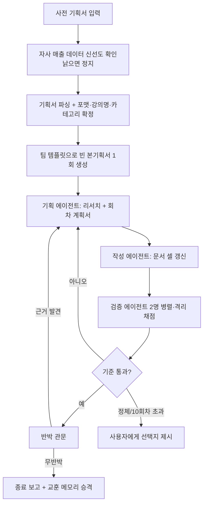

# 기획·작성·검증 에이전트를 루프로 돌려, 채점 기준을 넘길 때까지 기획서를 스스로 고치게 한 하네스

> 통과된 사전 기획서를 받아 팀 채점 5개 기준을 넘을 때까지 기획 에이전트 · 작성 에이전트 · 검증 에이전트 2명을 반복 실행하고, 결과를 팀 양식 문서에 직접 써 넣는다.

| 역할 | 기간 | 사용 도구 |
|---|---|---|
| 기획·설계·운영 (온라인 교육 플랫폼 Fastcampus(데이원컴퍼니) 콘텐츠 PM) | 2026-07 ~ 운영 중 (1세대 2026-03~05) | Claude Code (서브에이전트·스킬), Python, Google Docs API |

## 문제
- 강의 본기획서(CE)는 포맷 6종마다 양식이 다르고, 시장·페인·대체재 조사와 자사 매출 비교, 팀 양식 서식 준수까지 한 사람이 며칠씩 쓴다. 채점은 5개 기준으로 사람이 한다.
- 실제 채점 사례를 모아 보니 5개 기준을 모두 넘긴 기획서는 한 건도 없었고, 가장 약한 기준은 "자·타사 유사 강의 성과"였다. 외부 플랫폼 경쟁 강의를 조사한 흔적이 없었다.
- 1세대 자동화는 1,000줄이 넘는 단일 스킬이었다. 경로가 하드코딩되었고 문서 쓰기 모듈이 사라져 유지보수가 불가능했다.

## 접근 — 왜 이렇게 설계했나
1. **채점 기준을 그대로 종료 조건으로**: "다 썼다"가 아니라 "검증 에이전트 채점이 기준선을 넘었다"를 종료 조건으로 삼았다. 기획서 5개 기준을 루브릭(1·3·5점 앵커)으로 만들고, 실제 채점 시트에서 앵커 문단과 few-shot 사례를 뽑아 검증자에 주입했다.
2. **역할 분리와 모델 라우팅**: 리서치·논증 품질이 상한을 정하므로 기획 에이전트에 가장 강한 모델을, 계획서를 서식대로 옮기는 작성 작업과 고정 루브릭 채점에는 가벼운 모델을 썼다.
3. **검증자 2명을 서로 격리**: 기획자 관점과 마케팅 관점 검증자가 서로의 결과를 못 보게 해 채점 오염을 막고, 같은 기준에 지시가 둘이면 둘 다 다음 회차에 전달한다.
4. **반박 관문**: 기준을 넘긴 직후 한 번 더 "아직 기준 미달이어야 하는 이유"를 찾게 한다. 근거가 나오면 루프를 재개한다. 후한 채점을 구조로 막기 위함.
5. **풀 수 없는 기준은 정직하게 제외**: 강사 개인 채널 홍보력은 실제 섭외 컨택이 있어야 올라가므로 종료 판정에서만 뺐다. 점수 기록은 그대로 남겨 목표를 몰래 낮추지 않았다. 정체되면 포맷을 임의로 바꾸지 않고 선택지 3개를 사용자에게 올린다.
6. **매 회차 새 컨텍스트로 재진입**: 상태는 대화가 아니라 파일(회차 기록, 문서 URL)에서 복원한다. 긴 루프에서 컨텍스트가 오염되는 문제와 중복 문서 생성을 동시에 막았다.
7. **조용한 오쓰기 차단**: 문서 셀 라벨이 충돌하면 엉뚱한 칸에 쓰는 대신 예외를 던지고, 병합 셀에 삼켜진 좌표는 거부한다. 서식 규칙(긴 줄표 금지, 가짜 표 금지, 진짜 중첩 표 사용)은 쓰기 단계에서 코드로 검사한다.

## 만든 것

- 파이썬 라이브러리 약 10개 모듈(문서 읽기·쓰기, 매출 로더, 대체재 후보 추출, 회차 상태, 보정, 서식 가드)과 포맷 6종 명세(JSON), 에이전트 프롬프트 5종.
- 대체재는 2단계로 확정한다: 자사 매출 데이터에서 후보를 뽑고, 실제 상세페이지를 열어 수강 대상·기대 효과를 대조해 검증. 대체재가 없다는 결론이어도 탈락 기록과 부재 이유를 남기게 했다(조사 안 함과 조사했으나 없음을 구분).

## 결과 (Before → After)
- 실전 기획서 1건을 두 번 돌렸다. 첫 실행은 5회차에 강사 제외 4개 기준이 모두 기준선을 넘었고, 같은 입력을 백지에서 다시 돌린 두 번째 실행은 **3회차**에 4개 기준 통과 + 반박 관문 무반박으로 끝났다.
- 두 번째 실행 중 하네스 결함 2건(표 갱신 시 중첩 표가 사라지는 문제, 병합 셀 좌표 오배치)을 발견해 고쳤고 테스트는 117개에서 132개로 늘었다.
- 점수는 AI 검증자의 예측치이며 실제 팀 채점과의 일치는 아직 검증하지 못했다. 작성 시간 절감도 회차 수만 기록되어 정량화하지 않았다.

## 배운 점
- 루프의 성패는 생성 모델보다 종료 조건 설계에 달려 있다. 사람이 채울 수 없는 기준을 섞으면 영원히 안 끝나므로, 제외 항목은 이유와 함께 코드에 명시해야 한다.
- 검증자는 같은 정보를 보더라도 문서를 어떻게 읽히는지가 결과를 바꾼다. 중첩 표를 못 읽는 도구로 덤프하자 "표가 없다"며 감점했다. 검증 입력 품질이 채점 품질이다.
- 외부 API의 "비우기"는 기본값으로 채우기일 수 있다. 색 지우기 요청이 셀을 검게 칠한 사고 후, 쓰기 후에는 반드시 독립적으로 읽어 확인한다.
- 1세대의 큰 단일 스킬을 쪼갠 것이 가장 큰 개선이었다. 규칙은 데이터(JSON·루브릭)로, 흐름은 스킬로, 서식은 코드로 분리하니 각각 독립적으로 고칠 수 있었다.
