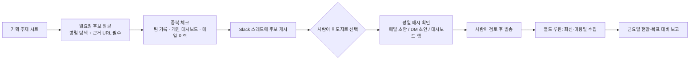

# 매주 연사 후보 발굴부터 컨택 초안까지, 사람은 고르고 보내기만 하는 파이프라인
> 주간 자문 미팅 목표를 맞추기 위해 후보 탐색·중복 확인·초안 작성·현황 보고를 자동화하고, 판단과 발송은 사람에게 남긴 업무 자동화.

| 역할 | 기간 | 사용 도구 |
|---|---|---|
| 기획·설계·운영 (온라인 교육 플랫폼 Fastcampus(데이원컴퍼니) 콘텐츠 PM) | 2026.10 ~ 운영 중 | AI 브라우저 에이전트(Aside), Google Sheets, Gmail, Slack, JavaScript |

## 문제
회사 목표로 "매주 일정 수 이상의 자문 미팅, 그중 일부는 처음 만나는 연사"가 생겼다. 이 목표를 채우려면 매주 같은 일을 반복해야 했다. 기획 중인 강의 주제에 맞는 후보 찾기, 팀 전체 컨택 기록(천 행 이상)과 대조해 이미 연락된 사람 거르기, 사람마다 톤이 다른 메일 쓰기, 진행 현황 정리. 후보를 찾는 것보다 대조와 정리에 시간이 더 들었고, 다른 담당자가 먼저 연락한 사람에게 중복 연락할 위험도 있었다.

## 접근 — 왜 이렇게 설계했나
- **전부 자동화하지 않았다.** 사람 관계의 첫 접점이라 "누구에게, 어떤 톤으로 보낼지"는 사람이 정한다. 자동화는 그 판단 직전까지 재료를 모으고, 판단 직후에 초안을 만드는 두 구간에만 넣었다. 메일은 임시보관함 초안까지만 만들고 발송은 항상 사람이 한다.
- **입력을 이모지 하나로 줄였다.** 처음엔 댓글 명령어(`보냄 1 7`)를 만들었다가, 실제로 쓰는 사람 입장에서 이모지가 가장 가볍다고 판단해 후보 메시지에 이모지만 달면 되게 바꿨다. 이모지 종류가 곧 톤이다(강하게 제안 / 가볍게 커피챗 / 보류 / 취소).
- **후보의 기준을 줄였다.** "주의 문구가 너무 많으면 후보를 고를 이유가 없다"는 피드백으로, 실무 이력과 AI 활용이 둘 다 제3자 근거(기사·크레딧·작업물)로 확인된 사람만 올리게 했다. 모자라면 적게 올리고 "후보 부족"으로 보고한다.
- **공용 자료는 읽기 전용.** 팀이 함께 쓰는 시트에는 쓰지 않고, 개인 대시보드에만 단일 셀 단위로 쓴다. 쓰기 전 백업, 쓴 뒤 독립적인 읽기로 검증한다. 초기에 공용 시트에 탭을 임의로 만든 일이 있어서 규칙으로 못 박았다.
- **수정 가능성을 위해 코드와 지침을 분리.** 공용 함수는 한 파일에, 판단 규칙과 템플릿은 스킬 문서에 둬서, 톤이나 기준이 바뀌면 문서만 고친다.

## 만든 것

- 스케줄 3개(주 1회 발굴, 평일 매시 처리, 평일 회신 수집)와 주차별 상태 파일, 메일 3종 템플릿(콜드 / 재컨택 / DM).
- 톤 분기: 실제 발송한 자문 메일 약 200건의 구조를 분석해 템플릿화했고, 연사의 맥락(신규 제안 / 이미 활동 중인 크리에이터 / 거절 후 재접촉)에 따라 문구를 달리한다.
- 세션 만료 대응: 사내 메신저 로그인이 풀리면 허용된 범위에서 자동 재로그인하고, 비밀번호가 필요한 단계에서는 즉시 멈춰 사람에게 넘긴다.

## 결과 (Before → After)
- Before: 후보 탐색·대조·초안 작성·현황 정리를 매주 수작업.
- After: 사람의 일은 이모지 선택, 메일 검토·발송, 미팅 날짜 입력으로 줄었다. 운영 첫 주에 후보 중 과반을 골라 초안까지 한 번에 만들었고, 그 주의 미팅 수와 신규 연사 수 모두 목표를 넘겼다(자동화만의 기여는 분리해 측정하지 않았다).
- 절감 시간은 따로 측정하지 않아 수치로 말하지 않는다. 대신 중복 연락 방지와 현황이 항상 시트에 남는다는 점이 정성적 효과였다.

## 배운 점
- 외부 서비스 로그인에 의존하는 자동화는 세션 만료가 가장 흔한 장애다. 운영 3주차에 로그인이 풀려 한 주의 처리가 멈춘 적이 있어, 재로그인 경로를 분리하고 "같은 오류에서 재시도하지 않고 종료·보고"하는 규칙을 둬야 했다. 다음 개선 과제는 "주간 발굴이 실행되지 않았음"을 스스로 알리는 점검이다.
- 사람이 최종 판단하는 자리를 남기면 자동화에 대한 신뢰가 빨리 쌓인다. 반대로 사람이 쓰기 불편한 입력 방식은 기능이 좋아도 쓰이지 않는다.
- 공용 데이터에 쓰지 않는다는 경계를 처음부터 정해야 사고 후 되돌리는 비용이 없다.
