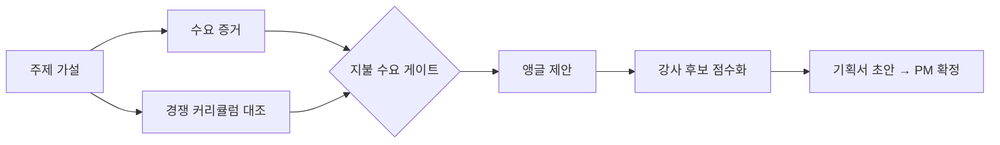

# AI로 강의 기획 리서치를 표준화한 방법
> 신규 강의 후보마다 흩어지던 수요 증거, 경쟁 대조, 강사 후보 탐색을 "지불 수요 게이트" 기반 공통 절차로 묶어 반복 가능하게 만들었다.

| 역할 | 기간 | 사용 도구 |
|---|---|---|
| 콘텐츠 PM (기획 판단·검증·교정) | 2026.09~ | Aside(브라우저 에이전트), Claude Code, Google Docs/Sheets, 매출 대시보드 |

## 문제
온라인 교육 플랫폼 Fastcampus(데이원컴퍼니)에서 강의 한 편을 기획하려면 "시장이 있는가, 경쟁이 이미 풀었는가, 누가 가르칠 것인가"를 증명해야 한다. 근거가 커뮤니티, 경쟁 플랫폼, 내부 매출에 흩어져 있고, 관심 신호(조회수·찜)를 수요로 착각하기 쉽고, 강사 후보 기준은 주제마다 새로 정해야 했다. 동시에 여러 주제를 검토할수록 품질이 들쑥날쑥했다.

## 접근 — 왜 이렇게 설계했나
- 지불 수요 게이트: 커뮤니티 언급량이나 찜 수는 "관심 신호"로만 분류하고, 실거래 매출로 지지될 때만 수요로 인정한다.
- 경쟁 인용 규칙: 키워드가 같다는 이유가 아니라 커리큘럼을 열어 같은 주제를 다루는 것을 확인한 뒤에만 경쟁 사례로 쓴다. 결과적으로 "경쟁이 없다"는 주장이 "시도는 있었지만 성공한 강의가 없다"처럼 정확해졌다.
- 병렬 조사 + 사람의 교정: 서브에이전트가 병렬로 수집하고, PM이 비교 기준(같은 층끼리 비교, 환율 통일, 출처 보존)을 지적하면 규칙으로 누적한다.
- 강사 후보 점수표: 권위·앵글 적합·신선도·실현성을 가중치로 두고, 공개적으로 검증 가능한 실명·경력이라는 통과 조건(게이트)을 둔다.

## 만든 것

- 8개 강의 기획 케이스(버츄얼, 3D 게임, 숏폼 자동화, UX/UI·PM, 엔터 VFX, 편집, 광고 편집 등)의 공통 조사 절차와 케이스별 근거 기록.
- 비용 조사용 3파트 틀(캐릭터 비용, 부가 비용, AI 대체 비용)과 2D/3D 단계 대응표.
- 반복 오류를 막는 운영 규칙 모음 (환율 통일, 층 일치, 출처 보존, 병렬 수집 한도).

## 결과 (Before → After)
- 주제당 수일의 수작업 리서치 → 반나절 내 근거 표와 후보 점수표 (정확한 시간은 측정하지 않음).
- 1명이 동시에 8건 안팎의 기획을 병렬로 진행하면서 같은 절차로 비교 가능.
- "경쟁이 없다" 같은 과장 문구가 검증 단계에서 교정되어 기획서의 반박 가능성이 낮아졌다.

## 배운 점
- AI가 만든 조사 결과의 가장 큰 리스크는 틀린 숫자보다 "기준이 어긋난 비교"였다. 비교 기준을 사람이 먼저 못 박아야 한다.
- 공개 정보로는 확인되지 않는 항목(내부 인력 통계 등)이 반드시 나오며, 이를 "확인 불가"로 남기는 습관이 신뢰를 만든다.
- 빠른 병렬 수집은 외부 사이트 차단을 부를 수 있어, 속도보다 순차·간격 수집이 결과적으로 빨랐다.
