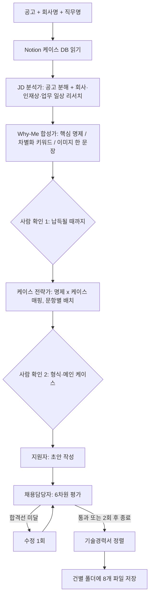

# 지원 서류를 "경험 나열"에서 "왜 나여야 하는가"로 바꾼 5-에이전트 자소서 엔진
> 공고 하나를 넣으면 회사 리서치, 핵심 명제 합성, 케이스 배치, 초안, 채용담당자 시점의 평가·수정, 기술경력서 정렬까지 한 흐름으로 돌아가는 Claude Code 스킬.

| 역할 | 기간 | 사용 도구 |
|---|---|---|
| 기획·설계·운영 (콘텐츠 PM으로서 직접 설계하고 직접 사용) | 2026.05 (설계 2026-05-06, 구조 개편 2026-05-31) | Claude Code(스킬·서브에이전트), Notion(케이스 DB), 웹 검색 |

## 문제
- 지원 서류를 회사마다 처음부터 쓰면 결국 "내가 한 일 나열"로 끝난다. 회사·직무가 달라져도 어필 포인트가 달라지지 않았다.
- 자소서, 기술경력서, 포트폴리오 요약이 따로 놀아 서류 전체에서 하나의 인상이 남지 않았다.
- 1세대 버전(포지셔닝 문서와 자소서 템플릿 방식)은 일반론으로 읽혀 탈락 사례로 분류하고 처음부터 다시 설계했다.

## 접근 — 왜 이렇게 설계했나
1. **선별 기준 1순위를 "정량 성과"가 아니라 "이 회사·이 직무에서 왜 이 사람인가"로 바꿨다.** 수치와 역량 매칭은 보조 근거로 내렸다. 그래서 가장 앞단에 Why-Me 합성 에이전트를 두고, 이 결과가 확정된 뒤에만 이후 단계가 시작되도록 했다.
2. **사람은 두 번만 개입한다.** Why-Me 명제(납득될 때까지, 최대 3라운드)와 자소서 형식·메인 케이스(1회). 나머지는 에이전트가 이어받는다. 개입 지점을 줄이되, 방향이 틀리면 크게 어긋나는 지점에는 반드시 사람의 확인을 넣었다.
3. **채점자를 에이전트로 만들어 루프 안에 넣었다.** 채용담당자 역할의 에이전트가 6개 차원으로 평가하고, 합격선(가중 평균 4.0 이상, Why-Me 입증력 4.0 이상, 어떤 차원도 3.0 미만 금지)에 못 미치면 초안을 한 번 더 고친다. 무한 수정을 막으려고 작성 라운드는 2회로 못 박았다.
4. **근거 데이터는 한 곳에 두고 매번 새로 읽는다.** 경력 케이스는 Notion DB 한 곳을 단일 원천으로 두고 로컬 캐시를 만들지 않았다. 오래된 사본이 서류에 섞이는 사고를 막기 위해서다.
5. **서류 간 일관성을 구조로 보장한다.** 자소서와 기술경력서가 같은 키워드 셋과 같은 "이미지 한 문장"을 공유하도록 마지막 단계에서 정렬한다.

## 만든 것 (구조)

- 프롬프트 5개(분석·합성·전략·작성·평가) + 지원자 정체성 문서 + 경력기술서 작성 규칙(5~7개 프로젝트, 기간/성과/역할/기술 4요소)을 파일로 분리해, 각 에이전트가 필요한 문서만 읽도록 했다.
- 금칙 표현(추상적 다짐, 수동태, 시간순 나열, 책임 분산)을 정체성 문서에 명시하고, 서술을 "상황 → 판단 → 행동 → 결과" 4단으로 고정했다.
- 건별 결과물(분석, 합성, 전략, 초안, 평가, 최종본, 정렬된 경력서, 메타데이터)을 날짜·회사·직무 이름의 폴더에 저장하고, 메타데이터에 명제·키워드·평가 점수·사용한 케이스 ID를 남겨 나중에 비교할 수 있게 했다.

## 결과 (Before → After)
- Before: 회사마다 경험을 처음부터 정리하고, 서류별로 키워드와 톤이 달라지기 쉬운 수작업.
- After: 같은 케이스 DB에서 회사·직무별 핵심 명제를 먼저 합성하고, 자소서와 기술경력서가 같은 키워드로 정렬된다. 채용담당자 시점의 평가가 초안 품질을 사전 점검한다.
- 실제 실행은 2건으로, 1건은 자소서 전체 과정(평가 점수는 5점 만점 중 4점대 초반에서 합격선 통과), 1건은 Why-Me 합성(2라운드)과 기술경력서 정렬로 진행했다.
- 작성 시간 절감률이나 서류 통과율은 기록하지 않아 확인할 수 없다.

## 배운 것
- 가장 큰 개선은 에이전트를 늘린 것이 아니라 **기준을 바꾼 것**이었다. 성과 수치 중심 선별에서 "이 회사에서 왜 나인가"로 바꾸자 이후 단계의 판단이 모두 같은 방향을 가리켰다.
- 사람의 확인은 많을수록 좋은 게 아니라 **되돌리기 비싼 지점 앞**에 두는 것이 효과적이다.
- 결과 기록에 합격·불합격을 남기는 필드가 없어서 엔진이 실제로 효과가 있었는지 검증하지 못했다. 다음 버전에는 결과 회수 필드가 필요하다.
