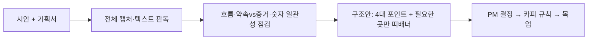

# 상세페이지 자동 생성 3번의 실패에서 얻은 것: 생성 대신 논리 점검
> 강의 상세페이지를 AI로 "만들어내는" 시도가 세 번 막힌 끝에, AI를 제작이 아닌 구조·논리 점검에 쓰는 방식으로 전환했다.

| 역할 | 기간 | 사용 도구 |
|---|---|---|
| 콘텐츠 PM (요구 정의·평가·구조 설계) | 2026.03~ | Claude Code, Codex, Gemini API, Aside, Figma |

## 문제
온라인 교육 플랫폼 Fastcampus(데이원컴퍼니)에서 강의 상세페이지는 매출을 좌우하는 핵심 자산이지만, 여러 사람이 고치다 보면 제목과 본문의 핵심 도구가 달라지고 숫자나 약속이 어긋난다. 한편 "기획서를 넣으면 페이지가 나오는" 자동 생성은 보기에는 완성돼도 팔리는 구조가 아니었다.

## 접근 — 왜 이렇게 설계했나
세 번의 시도와 학습이 설계의 근거다.
1. 기획 메모 승인 후 LLM이 HTML을 한 번에 생성: 사람 승인 단계는 좋았지만 서사 흐름과 반론 처리를 못 잡고, 긴 출력은 부분 수정이 어려웠다.
2. 팀의 섹션 단위 에이전트 파이프라인: 섹션이 독립 블록으로 나열돼 훅-공감-해결-증거로 이어지는 아크가 없고, 강사 소개가 앞에 오는 등 순서 규칙이 구조에 반영되지 않았다. 본인은 사람이 만든 페이지와 에이전트 산출물을 비교하는 갭 분석을 맡았다.
3. 제작 전 "판매력 진단"(시장 견인, 오퍼 명확성 등 6항목): 문제를 "주제가 잘될까"에서 "주어진 강의를 어떻게 보이게 해야 가장 팔릴까"로 재정의했다.
결론: 생성 품질을 올리는 것보다 사람이 만든 시안의 논리 오류를 일찍 찾는 편이 가치가 컸다.

## 만든 것

- 점검 항목: 제목과 본문 핵심의 일치, 훅과 페인포인트의 연결, 약속한 개수와 실제 카드 수, 이전 강의 자산 잔존.
- 구조 규칙: 강의 가치를 4개 포인트로, 띠배너는 맥락이 끊기는 곳에만, 숫자 근거는 날짜와 함께.
- 전달 규칙: 목업은 첫 화면부터 마지막까지 한 장의 이미지로.

## 결과 (Before → After)
- 시안 한 건에서 구조·숫자·약속 불일치 10건 이상을 한 번에 목록화 (이전에는 런칭 직전 육안 대조).
- 자동 생성 실험들에서 "서사 아크 부재, 순서 규칙 미반영, 요약 금지 규칙 필요"라는 구체적 요구사항을 도출해 다음 시스템 설계 기준으로 남김.
- 정량적 시간 절감은 측정하지 않았다.

## 배운 점
- 자동 생성은 "예쁘다"와 "팔린다"를 구분하지 못한다. 평가 기준(판매력 진단)을 생성보다 먼저 두어야 한다.
- 에이전트의 가장 안정적인 쓰임은 대체가 아니라 전수 대조다. 사람이 놓치는 숫자·문구 불일치를 지치지 않고 찾는다.
- 사용자가 실시간으로 수정하는 문서는 매 턴 현재 상태를 다시 확인해야 한다.
