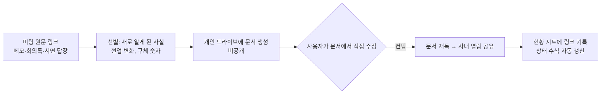

# 미팅 전사록을 팀이 바로 읽는 인사이트 문서로, 두 번 갈아엎은 문서 자동화 스킬
> 외부 전문가 미팅 기록을 공유용 문서로 정리하는 스킬을 만들고, 사용자 피드백으로 "문서 형식"보다 "글의 목소리"를 고쳐 나간 과정.

| 역할 | 기간 | 사용 도구 |
|---|---|---|
| 기획·설계·운영 (온라인 교육 플랫폼 Fastcampus(데이원컴퍼니) 콘텐츠 PM) | 2026.09 ~ 운영 중 | AI 브라우저 에이전트(Aside), Google Docs / Sheets, Slack, JavaScript |

## 문제
외부 전문가와 미팅을 하고 나면 전사록이나 메모가 남는데, 팀과 의사결정자가 읽을 문서로 정리하는 데 미팅 시간만큼의 시간이 든다. 처음 만든 자동화의 결과물은 전사록을 거의 그대로 옮긴 3천 자짜리 문서였고, "너무 길다"며 첫 실행에서 바로 반려됐다.

## 접근 — 왜 이렇게 설계했나
- **v1 (2026.09): 미팅로그 + 팀 채널 공유 초안.** 팀 템플릿을 복사해 문서를 만들고, 팀 채널에 올릴 요약 초안을 만든다. 채널 게시는 초안을 보여주고 승인받은 뒤에만 한다. 첫 결과물 반려 후 "압축·들여쓰기 계층(태그 → 근거 → 예외)·핵심 강조" 규칙을 스킬에 넣었다.
- **v2 (2026.10): 자문 미팅 → 공유용 인사이트 문서.** 사용 맥락이 강사 계약 미팅에서 자문 미팅으로 바뀌어 v1은 보관하고 같은 스킬을 다시 만들었다. 새 스킬을 따로 만들지 않고 기존 이름과 설치 경로를 유지했다.
- **두 단계 흐름.** 1단계는 내 드라이브에 비공개 초안을 만들어 링크만 전달. 사용자가 문서에서 직접 고친 뒤 "컨펌"이라고 하면, 2단계에서 문서를 다시 읽고(사용자가 고쳤을 수 있으므로) 사내 열람 권한을 열고 진행 현황 시트의 해당 행에 링크를 기록한다. 에이전트가 팀 공유 시트에 직접 쓰지 않는다.
- **글의 목소리를 규칙으로.** 사용자 피드백이 형식이 아니라 문체에 집중됐다. 문장마다 붙는 "(이름 날짜)" 꼬리표, AI 말투의 메타 라벨, "확인 필요" 섹션을 모두 금지했다. 본문은 인터뷰이의 말 그대로, 에이전트가 조사한 사실은 맨 아래 비고에만 둔다. 확인이 안 된 것은 문서에 남기지 않고 채팅으로 먼저 묻는다.
- **동일인 오인 방지.** 원문에서 이름과 링크가 나란히 있어도 같은 사람이라고 가정하지 않고, 각각 따로 검색해 확인하도록 했다. 첫 실행에서 서로 다른 두 사람을 한 사람으로 묶을 뻔한 사례에서 나온 규칙이다.

## 만든 것

- 고정 섹션: 정보 표 → 한 줄 요약 → 핵심 인사이트 → 의사결정자 질문 4개 → 교육 상품 시사점 → 강의 가능성·다음 액션 → 비고.
- 현황 시트의 상태·다음 액션 칸은 "인사이트 문서 링크가 있고 결과가 비어 있으면 미팅 완료 / 결과 정하기"로 자동 바뀌게 수식을 확장했다.
- 팀원 배포용으로 두 가지 패키지도 만들었다. 브라우저 에이전트용, 그리고 Aside가 없는 Windows 동료를 위한 Claude Code / Codex용(API 호출 기반).

## 결과 (Before → After)
- Before: 미팅마다 전사록을 읽고 사람이 정리하는 데 수 시간, 정리 방식은 사람마다 다름.
- After: 원문 링크 하나로 초안이 나오고 사람은 고쳐서 "컨펌"만 한다. 운영 1~2주 동안 다섯 건 안팎의 인사이트 문서를 같은 흐름으로 만들었다. 절감 시간은 측정하지 않았다.
- 규칙이 쌓일수록 수정 요청이 형식에서 내용 판단(예: 강의 가능성 의견은 참석자가 정함)으로 옮겨 갔다.

## 배운 점
- 자동화의 합격선은 "형식을 맞췄는가"가 아니라 "사람이 쓴 것처럼 읽히는가"였다. 피드백을 받을 때마다 금지 규칙으로 스킬에 반영해 같은 지적을 반복하지 않게 했다.
- 사용자가 직접 고치는 단계를 흐름의 중간에 넣고, 이후 단계가 그 수정본을 다시 읽도록 하면 에이전트가 사람의 수정을 덮어쓰는 사고를 막을 수 있다.
- 쓰임새가 바뀌면 새로 만들기보다 같은 이름으로 갈아엎고 이전 버전을 보관하는 쪽이 사용자 습관(슬래시 호출명)을 지켰다.
