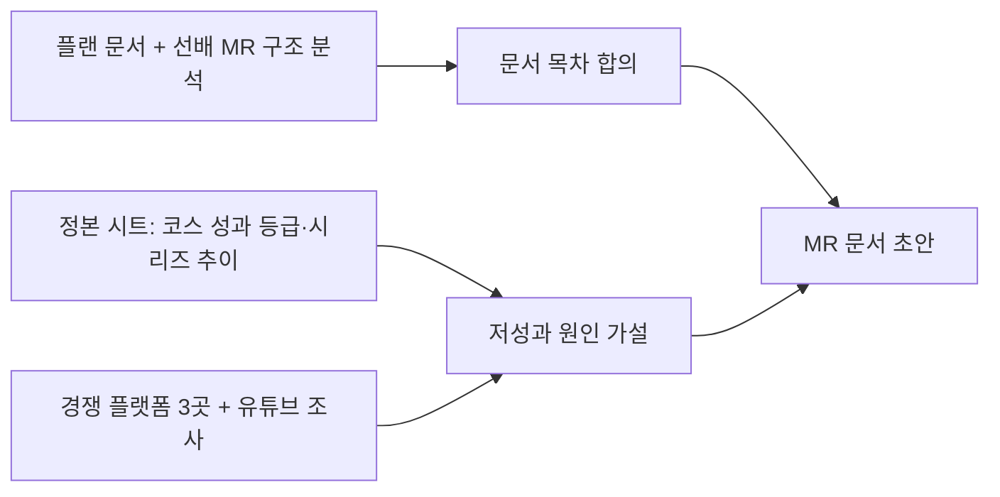

# 시장 리서치 문서를 하루 만에 초안까지: AI로 MR 작성 표준화
> 1,000여 개 코스 성과 분류, 경쟁 플랫폼 조사, 선배 문서 구조 분석을 AI와 묶어 반기 시장 리서치 문서의 초안 작성 시간을 크게 줄였다.

| 역할 | 기간 | 사용 도구 |
|---|---|---|
| 콘텐츠 PM (기획·분석·문서 작성) | 2026.08~ | Claude Code, Aside(브라우저 에이전트), Google Sheets/Docs |

## 문제
온라인 교육 플랫폼 Fastcampus(데이원컴퍼니)의 카테고리 PM은 반기마다 시장 리서치(MR) 문서를 쓴다. 성과 회고, 시장·고객 흐름, 대체재, 향후 라인업까지 담아야 하는데 내부 매출은 여러 곳에 흩어져 있고, 경쟁 플랫폼은 직접 훑어야 하며, 선배 문서마다 양식도 달랐다. 수치의 출처를 요구받는 문서라 속도와 정확도를 동시에 잡기 어려웠다.

## 접근 — 왜 이렇게 설계했나
- 양식부터 이해: 선배 MR 9개를 읽고 구조를 3가지 변형으로 분류한 뒤 우리 카테고리에 맞는 구조를 골랐다.
- 데이터 기준 고정: 내부 성과는 하나의 정본 시트를 기준으로 삼고 결제 시스템 값과 교차검증해 "숫자가 어디서 왔는지"를 고정했다.
- 근거 우선: 모든 주장에 출처와 날짜를 붙이고, 확인 안 된 것은 "확인 불가"로 남기는 규칙을 에이전트에 박았다.
- 사람이 판단: 문서 구성, 방향, 비교의 공정성은 PM이 계속 교정하고 AI는 수집·집계·초안을 맡았다.

## 만든 것

- 성과 등급 체계(60일 거래금액 기준 4단계)와 IP별 시리즈 지속력 비교.
- 경쟁 플랫폼별 조사 노하우(검색 방식, 페이지 구조, 신뢰할 수 있는 지표)를 재사용 가능한 메모로 정리.
- "시장 × 에이스 지도": 시장별 대표 강사가 없으면 그 시장 1등을 영입 후보로 올리는 라인업 프레임.

## 결과 (Before → After)
- 초안 작성: 레퍼런스 분석, 1,000여 개 코스 분류, 대체재 조사를 거쳐 하루 안에 초안(v0.2~v0.3)까지 도달.
- 품질: 신규 코스 중 약 3분의 2가 저성과라는 사실과 AI 강의 비중의 급증(수년간 약 11% → 약 64%)처럼 라인업 판단에 직접 쓰이는 발견을 문서에 포함.
- 소요 시간의 정확한 전후 비교는 측정하지 않았다.

## 배운 점
- 요약 문장보다 출처 추적이 가능한 구조가 신뢰를 만든다. 원본 데이터와 URL을 끝까지 보존해야 사후 질문에 5분 안에 답할 수 있다.
- 서로 다른 층(기성품/오리지널/업체)을 섞은 비교표는 바로 지적받는다. 비교 기준을 먼저 고정해야 한다.
- 공개 사이트 조사는 로그인 게이트와 SPA 구조 때문에 "확인 불가"가 반드시 나온다. 이를 숨기지 않고 표시하는 것이 오히려 문서의 신뢰를 높였다.
