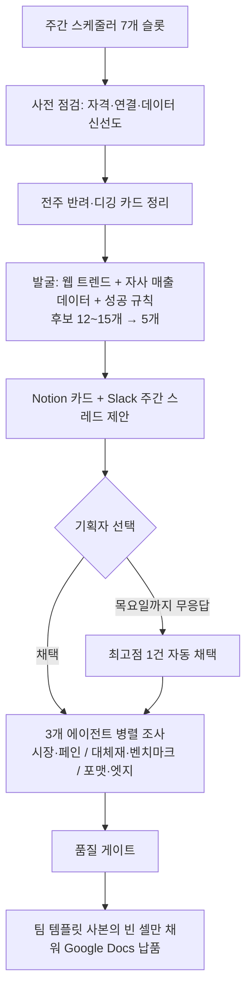

# 매주 신규 강의 기획서 초안을 사람 손 없이 목요일 아침까지 준비해 두는 자동화

> 주제 발굴 → 근거 조사 → 팀 양식 문서 작성까지 돌리고, 사람은 "5개 중 무엇을 채택할지"만 정하게 만든 주간 자동화 하네스.

| 역할 | 기간 | 사용 도구 |
|---|---|---|
| 기획·설계·운영 (온라인 교육 플랫폼 Fastcampus(데이원컴퍼니) 콘텐츠 PM) | 2026-07 ~ 운영 중 | Claude Code (headless), launchd, Slack API, Notion API, Google Docs API, Python |

## 문제
- 신규 강의는 매주 한 번 열리는 기획 미팅에 1페이지 사전 기획서를 올려야 통과 여부를 논의한다. 주제를 찾고, 근거를 모으고, 팀 양식을 채우는 일이 매주 반복되는 고정 업무였다.
- 처음 만든 자동화(키워드 포함 여부로 점수를 매기는 방식)는 미팅 결과와 점수가 어긋났다. 점수가 높아도 시장이 작다는 이유로 떨어지는 주제가 나왔고, 씨앗 입력은 여전히 사람이 했다.

## 접근 — 왜 이렇게 설계했나
1. **점수보다 좌표**: 모든 제안에 자사 실제 성과 사례 중 "이보다 낫다"는 상방 1건과 "이보다 좁다"는 하방 1건을 붙이고, 예상 성과는 범위로만 쓴다. "82점"보다 "실패한 그 강의 경로로 빠질 위험"이 판단에 잘 꽂힌다고 봤다.
2. **판단 기준을 코드 밖에 둔다**: 성공 규칙·예측 모델·사례를 별도 지식베이스 repo에 두고, 실행 때마다 최신본을 받아 쓴다. 기준이 바뀌어도 하네스를 고치지 않는다.
3. **방법론은 실제 결과를 보고 고친다**: 발굴 방식을 하루 동안 6번 돌려 보며 5단계로 진화시켰다(뉴스 우선 → 트렌드·매출 5:5 → 다방면 → 넓은 시장 우선 → 90점 루브릭). 마지막엔 "3초 안에 컨셉이 그려지는가", "끝나면 손에 남는 결과물이 있는가"를 하드 게이트로 두었다.
4. **상태의 진실원은 하나**: 주간 상태(대기/채택/완료)를 로컬 파일이 아니라 Notion DB 조회로 매번 계산한다. 로컬 캐시와 DB가 어긋나는 사고를 구조적으로 없앴다.
5. **사람의 결정은 3택으로 줄이고, 거절을 학습 자산으로 만든다**: 채택 / 반려(사유 기재) / 디깅(주제는 좋은데 상품화가 덜 됨). 반려 사유는 다음 발굴 프롬프트에 주입하고, 디깅은 새 근거가 생겼을 때만 되살린다.
6. **마감은 자동 안전장치**: 목요일이 되면 미선택 제안을 반려 처리하고 최고점 1건을 자동 채택해 작성에 들어간다. 빈손보다 수정 가능한 초안이 낫다는 판단.
7. **조용한 실패를 가장 경계**: 무인 실행에서 위험한 건 에러가 아니라 모르고 지나가는 실패다. 실패는 메신저 알림 → 안 되면 OS 알림 → 실행 로그 순으로 남기고, 별도의 읽기 전용 점검 작업이 평일 아침 상태를 요약한다.

## 만든 것

- 품질 게이트 예: 소비자 원문 발언 10건 이상, 경쟁 강의 5개 이상, 포맷 비교표 필수, 엣지에 내부 지표를 소구 문구로 쓰면 재작성.
- 팀 양식을 새 문서로 변환해 올리던 방식을 버리고 템플릿 사본의 빈 칸만 채우도록 바꿨다. 팀이 실제로 돌려보는 양식을 지키기 위해서다.
- 기획자가 메신저에서 리서치를 요청하면 결과를 주차별 문서로 저장소에 커밋하고, 다음 작성 실행이 그것을 최우선 브리프로 읽는다(자격증명이 없는 클라우드 세션이 가짜 문서를 만들지 못하게 한 설계).

## 결과 (Before → After)
- 사람의 필수 개입: 조사·작성 전체 → 제안 5건 중 채택 선택 1회.
- 가동 이력(2026-07-23 이후 실행 로그 기준): 실행 101건, 사전 기획서 7편 완성, 반려 사유가 달린 학습 데이터 50건 축적, 발굴 성공 15회(매번 5건 제안).
- 한계도 기록: 실행 성공률은 47/101. 실패 원인의 대부분은 로그인 세션 만료(18건)와 네트워크·절전(17건) 같은 환경 요인이고, 헤드리스 실행 설정 경고로 인한 중단(11건)은 해결 후 재발하지 않았다. 절감 시간은 별도 측정 기록이 없어 정량화하지 않았다.

## 배운 점
- 점수 체계는 사람 판단을 못 따라가는 순간부터 해롭다. 점수 옆에 "실패 경로" 문장을 붙이고, 판단 기준 자체는 결과를 보며 고치는 구조가 오래 간다.
- 자동화의 신뢰는 성공 시 품질이 아니라 실패 시 가시성에서 나온다. 알림이 너무 잦으면 무시되므로 일시적 네트워크 장애는 재시도 후에도 실패할 때만 알리게 조정했다.
- 스케줄러는 로그인 셸 환경을 상속하지 않는다. 실행 파일 경로 하나 때문에 한 주 작업이 전멸한 뒤, 환경 의존 코드를 추가할 때마다 실행 래퍼를 같이 점검하는 규칙을 문서화했다.
- 보호된 시스템 폴더에 자동화 자산을 두면 조용히 죽는다. 프로젝트 위치도 설계의 일부다.
