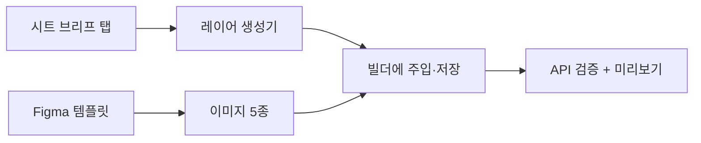

# 스프레드시트 한 탭으로 세미나 상세페이지 만들기
> 연사 정보를 담은 시트의 한 탭만 채우면, 사내 페이지 빌더 레이어와 이미지 5종까지 생성해 무료 세미나 상세페이지를 완성하는 워크플로우를 만들었다.

| 역할 | 기간 | 사용 도구 |
|---|---|---|
| 콘텐츠 PM (요구 정의·역할 경계 설정·검증) | 2026.09 | Aside(브라우저 에이전트), JavaScript, Google Sheets, Figma |

## 문제
온라인 교육 플랫폼 Fastcampus(데이원컴퍼니)는 연사와 함께 무료 세미나를 자주 연다. 세미나마다 사내 페이지 빌더에서 레이어 수십 개를 손으로 고치고, 피그마로 PC·모바일·프로필·썸네일·소셜 이미지를 만들고, 코스·상품·페이지를 각각 복제해야 했다. 연사 정보는 이미 시트에 있는데도 같은 내용을 여러 번 다시 입력하는 구조였다.

## 접근 — 왜 이렇게 설계했나
- 입력 한 곳: 담당자가 고치는 곳을 시트의 "값" 열 하나로 제한해, 실수 지점을 줄이고 개발 지식이 없어도 쓰게 했다.
- 사람이 바꾸면 안 되는 영역을 먼저 정의: 마케터 소관 항목(소셜 공유 문구, 슬러그, 프로모션 문구 등)은 자동화가 건드리지 않는다는 역할 경계를 확정했다.
- 실행 전 질문: 자료·녹화본 제공 여부처럼 페이지 문구가 달라지는 항목은 에이전트가 먼저 묻고 시작한다.
- 실패를 조용히 넘기지 않기: 값이 비어 있으면 경고로 올리고, 저장 후에는 시스템 API로 실제 반영 여부를 검증한다.

## 만든 것

- 브리프 → 레이어 생성기: 타임테이블 블록 수 자동 조정, 숨김 처리, 혜택 번호 재정렬, 링크 도메인별 SNS 아이콘 선택.
- 피그마 이미지 파이프라인: 미러링된 인물 레이어의 가시 영역을 마커 이미지로 측정해 사진을 정확히 배치.
- 위 전체를 호출형 스킬로 패키징(확인 → 이미지 → 생성 → 주입 → 검증 순서).

## 결과 (Before → After)
- 레이어 수십 개 수작업 + 이미지 5종 수작업 + 복제 3종 → 시트 한 탭 입력과 스킬 한 번 실행.
- 파일럿 세미나 1건으로 처음부터 끝까지 실제 동작 검증.
- 시간 절감 수치는 측정하지 않았다. 인물 사진 배치 품질은 아직 개선 과제로 남아 있다.

## 배운 점
- 화면에 보이지 않는 실패가 가장 비싸다. 폰트가 없으면 텍스트 편집이 조용히 무시되어 이틀을 허비했고, 이후 "반영 확인"을 절차에 넣었다.
- 자동화의 범위는 기능이 아니라 책임 경계로 정한다. 마케터 영역과 관리 영역을 먼저 빼는 것이 신뢰를 만들었다.
- 비개발자 사용자에게는 "무엇을 하는가(시트 → 페이지 번역기)"로 설명해야 도입된다.
