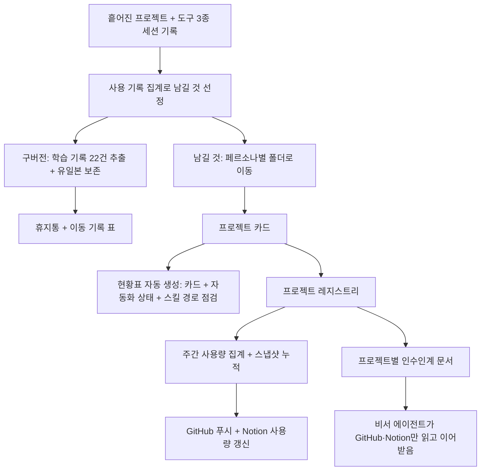

# 흩어진 AI 프로젝트를 하루에 재편하고, 에이전트가 이어받을 수 있게 만든 작업환경 시스템
> Claude Code·Codex·Aside를 섞어 쓰며 여기저기 쌓인 프로젝트를 페르소나별 구조로 정리하고, 현황표와 사용량 집계, GitHub·Notion 인수인계까지 자동화한 작업.

| 역할 | 기간 | 사용 도구 |
|---|---|---|
| 기획·설계·실행 (정리 기준 수립, 학습 기록 추출, 자동화 구축) | 2026.10.29 ~ 10.30 | Claude Code, Codex, Aside, Python, launchd, Notion, GitHub |

## 문제
- 온라인 교육 플랫폼 Fastcampus(데이원컴퍼니)에서 콘텐츠 PM으로 일하며, 업무 자동화를 AI 도구 세 가지(Claude Code, Codex, Aside)로 나눠 만들었다. 도구마다 작업 폴더가 달라 프로젝트가 문서 폴더, 다운로드 폴더, 앱이 만든 날짜별 임시 폴더에 흩어졌다.
- 같은 규칙과 자료가 4곳에 중복되어 어느 것이 최신인지 알 수 없었고, 폴더를 옮기며 스킬이 고아가 된 경우(코드 폴더가 사라져 실행이 실패)도 있었다.
- 클라우드 동기화 폴더에 둔 자동화가 권한 오류로 중단된 사고가 있었다.
- "지금 무엇이 실제로 쓰이는지"를 알 방법이 없어서, 남길 것과 버릴 것을 정할 근거가 없었다.

## 접근 — 왜 이렇게 설계했나
1. **삭제가 아니라 "학습 기록 추출 후 정리".** 폴더를 지우면 시도했던 맥락과 실패 이유도 사라진다. 그래서 정리 전에 프로젝트마다 무엇이었나 / 왜 멈췄나 / 무엇으로 이어졌나 / 지우면 잃는 것을 한 장으로 남겼다. 복구 불가한 유일본만 따로 보존했다.
2. **분류 기준은 도구가 아니라 맥락(페르소나).** 업무, 개인, 학교 세 가지로 나눴다. 도구는 바뀌어도 일의 맥락은 바뀌지 않기 때문이다.
3. **사용 기록으로 판단한다.** 세 도구의 세션 기록과 자동화 실행 로그를 프로젝트별로 집계해 "만들었지만 쓰지 않는 것"과 "계속 쓰는 것"을 구분했다.
4. **사람이 목록을 관리하지 않게 한다.** 프로젝트마다 카드 파일 한 장을 두고, 스크립트가 이를 모아 현황표를 만든다. 카드 형식이 곧 규칙이다.
5. **되돌릴 수 있게 한다.** 모든 이동·삭제를 이전 경로 → 새 경로 표로 기록하고 설정 파일을 백업했다. 영구 삭제는 에이전트가 하지 않고 사용자가 직접 하도록 규칙으로 못 박았다.
6. **마지막에는 다른 에이전트가 읽는 사람이 된다.** 로컬 파일을 볼 수 없는 비서 에이전트가 맥락을 이해하도록, 프로젝트별 인수인계 문서와 요약 데이터를 GitHub·Notion에 올리는 구조를 만들었다.

## 만든 것 (구조)

- **현황표 생성기**: 카드 정보와 함께 예약 작업·스케줄러 상태, 스킬의 파일 경로 유효성, 분류 안 된 폴더를 한 번에 점검해 "깨진 곳"을 경고한다.
- **사용량 집계기**: 세 도구의 세션 로그에서 프로젝트별 사용 횟수와 마지막 사용일을 센다. 세션 기록이 약 30일만 남는 도구가 있어 주간 스냅샷을 쌓아 장기 추이를 보존한다.
- **정리 규칙을 에이전트 공통 지침에 반영**: 새 프로젝트는 정해진 위치에만 만들고, 이동 시 참조하는 곳을 함께 수정하며, 버전이 끝나면 학습 기록을 먼저 남기도록 했다. 도구가 달라도 같은 규칙이 적용된다.
- **인수인계 구조**: 프로젝트 정의(레지스트리), 사람이 읽는 상세 문서, Notion 동기화용 요약, 사용량 지표, 사용자 프로필(일하는 방식·금지 사항)을 분리했다. 상태와 성과는 Notion을 최신으로 보고, 사용량만 자동 갱신한다.

## 결과 (Before → After)
- Before: 프로젝트가 여러 위치에 흩어지고 같은 규칙이 4곳에 중복. 스킬 일부가 고아 상태. 현황을 아는 방법은 기억뿐.
- After: 3개 페르소나 아래 프로젝트 카드 14장과 자동 생성되는 한 장짜리 현황표. 구버전 22건은 학습 기록으로 압축되었고, 정리된 경로 49건은 이동 기록으로 추적 가능. 스킬 경로 깨짐은 현황표 실행 때마다 자동 점검.
- 인수인계 대상으로 정의한 프로젝트 20개를 사용량·상태·운영 규칙과 함께 에이전트가 파악할 수 있는 구조.
- 정리에 쓴 시간이나 이후 업무 효율 변화는 기록하지 않아 정량으로는 확인할 수 없다.

## 배운 점
- **정리의 단위는 폴더가 아니라 "다음에 이어서 일할 수 있는가"**였다. 코드가 남아 있어도 맥락이 없으면 복구되지 않고, 코드를 버려도 맥락이 있으면 같은 시행착오를 줄일 수 있다.
- 사용 기록 집계에는 한계가 있다. 일부 도구는 기록 보관 기간이 짧고 일부는 본문 키워드로 근사한다. 그래서 수치마다 한계를 함께 적고 스냅샷을 쌓는 방식으로 보완했다.
- 비밀값(토큰·키)이 평문으로 들어 있던 설정 파일을 정리 과정에서 발견했다. 정리 작업의 체크리스트에 "삭제 전 비밀값 폐기 여부 확인"이 들어가야 한다.
- 자동화는 만드는 것보다 **누가 언제 갱신하는지**가 더 중요했다. 카드 파일을 규칙으로 만들고 갱신 스크립트를 한 줄 명령으로 줄이자 유지 부담이 줄었다.
